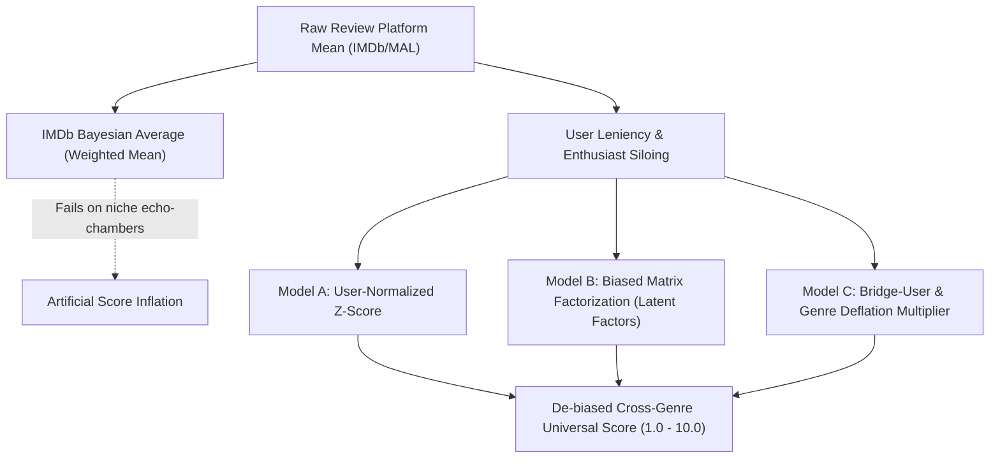

# UniversalRatingEngine 🎬
> **Decoupling movie quality from user leniency and genre echo chambers across 32 Million ratings.**

[](https://goved.github.io/UniversalRatingEngine/)
[](https://python.org)
[](https://pola.rs)
[-red.svg)](https://pytorch.org)
[]()

---

### 🌐 [**👉 Explore the Live Interactive Dashboard Here 👈**](https://goved.github.io/UniversalRatingEngine/)
*Explore calibrated scores for 19,669 titles from MovieLens 32M with fuzzy search, radar comparisons, genre macro-analytics, and instant CSV export.*

---

## ⚡ The 30-Second Summary

### Why are review platform scores misleading?
If you browse IMDb, MyAnimeList, or Letterboxd, you've probably noticed strange anomalies: niche psychological anime, cult horror, or obscure indie titles often boast **8.5+ ratings**, while widely loved comedies, action thrillers, and family films struggle around **6.5 to 7.2**.

Is that cult anime actually better than *The Godfather* or *Goodfellas*? **Usually, no.** It suffers from **self-selection bias**:

1. **Enthusiast Siloing (Echo-Chambers)**: Niche titles are rated almost exclusively by devoted fans who already love the genre. When only super-fans vote, ratings cluster unrealistically high (7.8 – 8.8+).
2. **Mainstream Audience Drag**: Broad, popular titles attract everybody—casual viewers, harsh critics, and mismatched audiences who disliked the genre—pulling average scores down.
3. **User Leniency Variance**: Some people give 9/10 to everything they enjoy; others never rate above 6/10. Simple arithmetic means and standard Bayesian weighted averages treat all ratings identically, ignoring who gave them.

### What does UniversalRatingEngine do?
**UniversalRatingEngine** is a high-throughput Python machine learning pipeline that strips out user leniency and genre echo chambers. 

Trained on the **MovieLens 32M benchmark dataset** (31.6M filtered ratings across 19,669 titles), it applies:
- **Model A**: User-Normalized Z-Score standardization to eliminate personal rating habits.
- **Model B**: Biased Matrix Factorization (PyTorch) to isolate **intrinsic item quality** ($b_i$) from user leniency ($b_u$) and personal taste affinities ($\mathbf{p}_u^T \mathbf{q}_i$).
- **Model C**: Shannon-entropy Bridge User calibration to measure and deflate genre-wide echo chambers.

The result is a calibrated, true **Universal Quality Score (1.0 – 10.0)** that enables fair, cross-genre comparison.

---

## 📦 Supported Datasets & Multi-Cohort Synthesis

UniversalRatingEngine natively supports multiple benchmark datasets and multi-source combinations:

| Dataset Identifier | Ratings Ingested | Filtered Titles | Description & Use Case |
| :--- | :---: | :---: | :--- |
| `ml-32m` | **31,637,476** | **19,669** | Flagship MovieLens benchmark. Maximum statistical power across modern cinema and TV. |
| `mal-57m` | **57,633,278** | **~16,800** | **Full MyAnimeList Benchmark (Valdivieso 2020)**. 57.6M explicit ratings across 310k+ users. |
| `mal-7m` | **7,813,737** | **~12,000** | **CooperUnion MAL Benchmark**. Classic medium-scale anime corpus. |
| `letterboxd` | **10,462,257** | **281,045** | **Letterboxd Benchmark**. Cinephile matrix addressing art-house anchoring and casual drag. |
| `ml-1m` | **990,457** | **3,175** | Curated historical benchmark (~2000 era). Dense rater interactions. |
| `mal` | **834,794** | **4,648** | Lightweight MyAnimeList sample for rapid prototyping and CI. |
| `ml-latest-small` | **57,291** | **869** | Lightweight modern corpus. Instant download and fitting (~0.5s). |
| `combined` | **58,431,869** | **16,532** | **Flagship Multi-Domain Synthesis (Cinema + MAL 57M Anime)**. Harmonizes MovieLens (historical & modern cinema) and MyAnimeList 57.6M into a unified cross-platform benchmark. |

### ⚠ Multi-Database Merging Methodology & Data Integrity Disclaimer

When selecting `combined` or merging disparate review databases, the engine applies four structural guarantees:

1. **Cohort Namespacing**: User IDs across databases do not represent the same people. The engine namespaces user IDs ($\text{userId} + 10^9 \cdot \text{cohort}$) so that each rater's individual bias ($b_u$) and personal variance ($\sigma_u$) are fit independently without artificial cross-platform identity collisions.
2. **Interaction Deduplication**: Repeated ratings on the same title by the same user are sorted by timestamp, preserving only the most recent interaction per viewer to eliminate multi-vote distortion.
3. **Iterative Dual-Threshold Pruning**: Cold-start filtering strictly enforces $\ge 15$ ratings/user and $\ge 30$ ratings/movie across the union graph.
4. **Longitudinal Synthesis Caveat**: While Model B isolates intrinsic item quality ($b_i$) by stripping away user leniency ($b_u$), merging cohorts spanning different historical decades (e.g., year 2000 vs. year 2018) captures evolving cultural reception, genre trends, and retrospective reappraisals. The calibrated score reflects a harmonized multi-era consensus.

---

## 🔍 Before vs. After: Real Examples from 32 Million Ratings

| Title | Genres | Raw IMDb/ML Mean | Universal Score | Rank Shift | Audience Diagnosis |
| :--- | :--- | :---: | :---: | :---: | :--- |
| **Neon Genesis Evangelion: End of Evangelion** | Animation, Sci-Fi | **8.06** (#331) | **7.42** (#1,049) | 🔻 **Dropped 718 ranks** | *Inflated by enthusiast siloing; loyalists rate 0.6 pts higher than general viewers.* |
| **Eraserhead** | Horror, Mystery | **7.56** (#938) | **6.96** (#2,109) | 🔻 **Dropped 1,171 ranks** | *Cult surrealist following inflated raw score; deflated under cross-genre calibration.* |
| **Young@Heart** | Documentary, Musical | **7.42** (#3,000) | **7.15** (#4,324) | 🔻 **Dropped 1,324 ranks** | *High niche enthusiasm in documentary/musical fan clusters.* |
| **Airplane!** | Comedy | **7.47** (#1,489) | **7.63** (#558) | 🔺 **Gained 931 ranks** | *Penalized by mismatched viewers; intrinsic comedy quality recognized upon calibration.* |
| **Meet the Parents** | Comedy, Romance | **7.02** (#4,055) | **7.33** (#1,402) | 🔺 **Gained 2,653 ranks** | *Strong mainstream crowdpleaser rescued from general audience downward drag.* |
| **Groundhog Day** | Comedy, Fantasy | **7.81** (#660) | **7.78** (#328) | 🔺 **Gained 332 ranks** | *Moves into top-tier cinema once harsh casual ratings are standardized.* |

---

## 🌐 Interactive Web Dashboard

Experience the complete calibrated dataset directly in your browser:  
🔗 **[https://goved.github.io/UniversalRatingEngine/](https://goved.github.io/UniversalRatingEngine/)**

- 🎬 **Film Explorer**: Real-time fuzzy search across 19,669 movies, year filters, and genre tags.
- ⚡ **Preset Quick Filters**: Instantly view **Top 100 Calibrated**, **Enthusiast-Inflated Titles**, or **Audience-Drag Casualties**.
- 🔬 **Deep Title Inspector**: Click any movie to reveal a radar chart decomposing Raw vs. Bayesian vs. Z-Score vs. Latent Quality vs. Bridge scores.
- 📊 **Cross-Genre Macro Analytics**: Interactive charts showing the exact inflation or deflation multiplier for all 19 genres.
- ⚖️ **Side-by-Side Compare**: Select up to 4 titles and compare their latent biases side-by-side.
- 💾 **One-Click CSV Export**: Download filtered views directly to CSV.

To run the web interface locally:
```bash
python3 -m http.server 8000 --directory docs
# Open http://localhost:8000 in your browser
```

---

## 🧮 Mathematical Architecture

UniversalRatingEngine formulates rating calibration through three complementary statistical lenses:



### 1. Model A: User-Normalized Z-Score Aggregator (Baseline)
Eliminates individual rater leniency (generous vs. harsh graders) by standardizing every interaction to zero mean and unit variance:
1. For each user $u$, calculate personal mean $\mu_u$ and standard deviation $\sigma_u$.
2. Standardize every rating:
   $$z_{ui} = \frac{r_{ui} - \mu_u}{\sigma_u + \epsilon}$$
3. Aggregate mean z-score across all raters of item $i$:
   $$\bar{z}_i = \frac{1}{|U_i|} \sum_{u \in U_i} z_{ui}$$
4. Re-project $\bar{z}_i$ onto the global rating population parameters:
   $$\hat{S}_i = \mu_{\text{global}} + (\bar{z}_i \cdot \sigma_{\text{global}})$$

### 2. Model B: Biased Matrix Factorization (Latent Factor Decomposition)
Decomposes observed ratings into global baseline, user leniency bias, intrinsic item quality bias, and latent interaction:
$$\hat{r}_{ui} = \mu + b_u + b_i + \mathbf{p}_u^T \mathbf{q}_i$$
- $\mu$: Global rating average.
- $b_u$: **User leniency bias** (how much easier or harsher user $u$ rates relative to $\mu$).
- $b_i$: **Intrinsic item quality bias** — the isolated metric of true cross-genre quality.
- $\mathbf{p}_u, \mathbf{q}_i \in \mathbb{R}^k$: Latent feature vectors capturing genre affinity and stylistic preferences ($k = 32$).

Optimized via PyTorch with AdamW and $L_2$ weight regularization:
$$\min_{b, p, q} \sum_{(u, i)} \left( r_{ui} - \mu - b_u - b_i - \mathbf{p}_u^T \mathbf{q}_i \right)^2 + \lambda \left( b_u^2 + b_i^2 + \|\mathbf{p}_u\|_2^2 + \|\mathbf{q}_i\|_2^2 \right)$$

The de-biased quality score on the $1.0 - 10.0$ scale is:
$$\hat{S}_{\text{latent}}(i) = \text{clip}(\mu + b_i, 1.0, 10.0)$$

### 3. Model C: Bridge-User & Shannon Entropy Genre Deflation Index
Measures and counteracts genre-level echo-chamber inflation:
1. **Genre Entropism Index**: For each user $u$, compute their genre consumption distribution $p_u(g)$ and normalized Shannon entropy:
   $$\tilde{H}(u) = \frac{-\sum_{g} p_u(g) \log_2 p_u(g)}{\log_2 |\mathcal{G}|} \in [0, 1]$$
2. **Bridge Users vs. Genre Loyalists**:
   - *Bridge Users*: Raters who consume across diverse genres ($\tilde{H}(u) \ge \tau_{\text{bridge}}$, top 30% diversity).
   - *Genre Loyalists*: Raters concentrated heavily in genre $g$ ($p_u(g) \ge 0.25$) with low overall diversity.
3. **Genre Multiplier ($M_g$)**:
   $$M_g = \frac{\bar{r}_{\text{bridge}, g}}{\bar{r}_{\text{loyal}, g}}$$
4. **Item Calibration**:
   $$S_{\text{bridge}}(i) = \text{clip}\left(\text{RawAvg}(i) \cdot \frac{1}{|G_i|} \sum_{g \in G_i} M_g, 1.0, 10.0\right)$$

---

## 🚀 Installation & Requirements

- Python 3.10+
- Linux / macOS / Windows
- PyTorch with CUDA/ROCm (GPU) or CPU support

```bash
git clone https://github.com/GoVed/UniversalRatingEngine.git
cd UniversalRatingEngine

# Install dependencies
pip install polars numpy scipy torch rich typer rapidfuzz pytest
```

---

## 💻 CLI Usage Guide

UniversalRatingEngine provides a full-featured terminal CLI with colored Rich outputs.

### 1. Download & Prepare Datasets
Automatically downloads, unzips, and filters cold-start noise (< 15 user ratings, < 30 item ratings):

```bash
# MovieLens Latest Small (instant testing, 100k ratings)
python -m src.data_loader --dataset ml-latest-small

# MovieLens 1M (curated benchmark, 1 million ratings)
python -m src.data_loader --dataset ml-1m

# MyAnimeList (57.6M ratings flagship dataset)
python -m src.data_loader --dataset mal-57m

# MovieLens 32M (flagship benchmark, 32 million ratings)
python -m src.data_loader --dataset ml-32m

# Combined Multi-Cohort Benchmark (ML-1M + ML-Latest)
python -m src.data_loader --dataset combined
```

### 2. Fit Calibration Models
Trains all three calibration engines and caches results to Parquet:

```bash
# Fit on Combined Multi-Cohort Benchmark (~1 second)
python run.py fit --dataset combined --epochs 10 --k 32

# Fit on MovieLens 1M (~1 second)
python run.py fit --dataset ml-1m --epochs 10 --k 32

# Fit on MovieLens 32M (GPU-accelerated, ~10 seconds for 31.6M rows)
python run.py fit --dataset ml-32m --epochs 5 --k 32 --batch-size 65536
```

### 3. Inspect Any Movie or TV Show
Inspect any title using exact or fuzzy name matching:

```bash
python run.py inspect "Neon Genesis Evangelion" --dataset ml-32m
```

**Terminal Output:**
```
╭─ Neon Genesis Evangelion: The End of Evangelion (Shin seiki Evangelion Gekij─╮
│ Movie ID:                      27156                                         │
│ Genres:                        Action|Animation|Drama|Fantasy|Sci-Fi         │
│ Ratings Count:                 1,727 reviews                                 │
│ Dataset:                       ML-32M (scale: 1.0 - 10.0)                    │
│                                                                              │
│ Raw Arithmetic Average:        8.06 / 10.0                                   │
│ IMDb / Bayesian Average:       8.03 / 10.0 (m=50 votes)                      │
│ Model A (User Z-Score):        8.22 / 10.0                                   │
│ Model B (Latent Quality b_i):  7.42 / 10.0 (bias b_i: +0.329)                │
│ Model C (Bridge Calibrated):   7.70 / 10.0 (genre mult: 0.956)               │
│                                                                              │
│ Raw Rank:                      #331 of 19,669                                │
│ Calibrated Rank:               #1,049 of 19,669                              │
│ Overall Rank Shift:            Dropped 718 ranks due to enthusiast bias      │
│ Calibration Delta (Δ):         -0.63 pts                                     │
╰──────────────────── UniversalRatingEngine v1.0 • ml-32m ─────────────────────╯
```

### 4. Generate Analytical Reports
Outputs complete Markdown analysis reports containing Top 25 enthusiast-inflated titles, Top 25 audience-dragged titles, and cross-genre summaries:

```bash
python run.py report --dataset ml-32m --output reports/ml-32m_calibration_report.md
```

### 5. Leaderboards & Head-to-Head Compare

```bash
# Top 20 Calibrated Titles Overall
python run.py top --dataset ml-32m -n 20

# Top 15 Sci-Fi Titles
python run.py top --dataset ml-32m -n 15 --genre Sci-Fi

# Head-to-head title comparison
python run.py compare "Toy Story" "Heat" "Seven Samurai" --dataset ml-1m
```

---

## 📊 Macro Analytical Findings (MovieLens 32M)

Across 31.6 Million ratings and 19,669 movies:

| Genre | Loyalist Avg | Bridge User Avg | Inflation Multiplier ($M_g$) | Genre Dynamics |
| :--- | :---: | :---: | :---: | :--- |
| **Musical** | 8.22 | 7.31 | **0.890** | -11.0% deflation; strong niche echo-chamber |
| **Romance** | 7.64 | 7.17 | **0.938** | -6.2% deflation; loyalists rate substantially more leniently |
| **Animation** | 7.78 | 7.39 | **0.950** | -5.0% deflation; enthusiast bias on cult releases |
| **Horror** | 6.42 | 6.38 | **0.994** | Broadly aligned between bridge and horror fans |
| **Drama** | 7.49 | 7.41 | **0.989** | Baseline genre; broad viewer base |
| **Comedy** | 7.02 | 7.08 | **1.009** | Slight upward adjustment; frequently penalized by casuals |

---

## 🧪 Running Tests

The test suite covers data loading, cold-start filtering, model convergence, metrics, and CLI commands:

```bash
pytest -v
```

```
============================== 17 passed in 1.19s ==============================
```

---

## 📁 Repository Structure

```
UniversalRatingEngine/
├── run.py                          # Typer + Rich CLI interface
├── pytest.ini                      # Pytest discovery settings
├── docs/                           # Interactive Web UI (GitHub Pages)
│   ├── index.html                  # Single-page application (Tailwind + Chart.js + KaTeX)
│   └── data/                       # Pre-compiled calibrated datasets (JSON & CSV for 5 benchmarks)
├── src/
│   ├── data_loader.py              # Polars loader, cohort namespacing & cold-start filtering
│   ├── engine.py                   # Central UniversalRatingEngine pipeline orchestrator
│   ├── metrics.py                  # Bayesian mean, rank deltas, diagnosis generator
│   ├── report.py                   # Markdown report generator & rich tables
│   ├── export_web_data.py          # Data exporter for web dashboard
│   └── models/
│       ├── z_score.py              # Model A: User-Normalized Z-Score
│       ├── matrix_factorization.py # Model B: Biased Matrix Factorization (PyTorch)
│       └── bridge_calibration.py   # Model C: Bridge-User & Genre Deflation Index
├── reports/                        # Pre-generated analytical Markdown reports
└── tests/                          # 17 comprehensive unit & integration tests
```

---

## 📜 License
MIT License. Open source and free to use for research and development.
