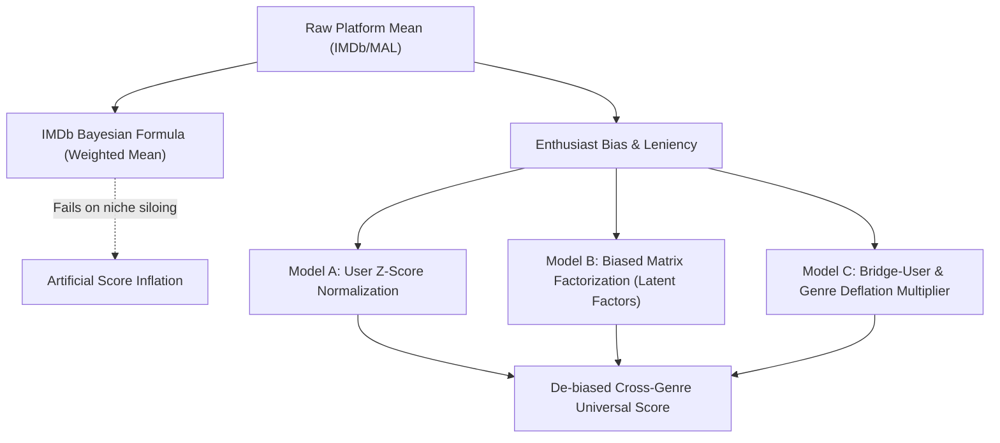

# UniversalRatingEngine: Cross-Genre Quality Calibration Report
**Dataset**: `ml-1m` | **Titles Evaluated**: 2,836 | **Total Ratings Evaluated**: 990,457

> [!NOTE]
> Public review platforms (IMDb, MyAnimeList, Letterboxd) suffer from severe self-selection bias and contextual anchoring. Niche genres attract loyalist enthusiasts who inflate scores, while broad mainstream titles suffer score drag from mismatched audiences. This report presents calibrated scores produced by decomposing user leniency and item latent quality.

## Global Dataset Overview
- **Population Mean (Raw 10-point Scale)**: `6.63 / 10.0`
- **Calibrated Latent Mean (Model B)**: `7.06 / 10.0`
- **Calibration Delta Range**: `[-1.55, +3.92]`
- **Maximum Rank Fall**: `786` ranks
- **Maximum Rank Rise**: `654` ranks

## 1. Top 25 Titles with Biggest Negative Calibration Delta
*Titles artificially inflated by niche enthusiast siloing and sympathetic user bases.*

| # | Title | Genres | Votes | Raw Avg | IMDb Bayes | Model A (Z) | Model B (Latent) | Model C (Bridge) | Delta (Δ) | Rank Shift |
|---|---|---|---|---|---|---|---|---|---|---|
| 1 | **Sanjuro (1962)** | Action, Adventure | 69 | 9.22 | 8.36 | 9.26 | **7.67** | 8.79 | `-1.55` | Dropped 13 ranks due to enthusiast bias |
| 2 | **Seven Samurai (The Magnificent Seven) (Shichinin no samurai) (1954)** | Action, Drama | 628 | 9.12 | 8.98 | 9.03 | **7.69** | 8.83 | `-1.43` | Dropped 5 ranks due to enthusiast bias |
| 3 | **Godfather, The (1972)** | Action, Crime, Drama | 2,223 | 9.05 | 9.01 | 8.96 | **7.65** | 8.84 | `-1.40` | Dropped 20 ranks due to enthusiast bias |
| 4 | **Shawshank Redemption, The (1994)** | Drama | 2,227 | 9.11 | 9.07 | 9.05 | **7.72** | 8.90 | `-1.39` | Gained 1 ranks due to harsh audience penalty |
| 5 | **Usual Suspects, The (1995)** | Crime, Thriller | 1,783 | 9.03 | 8.98 | 9.00 | **7.68** | 8.95 | `-1.36` | Dropped 3 ranks due to enthusiast bias |
| 6 | **Close Shave, A (1995)** | Animation, Comedy, Thriller | 657 | 9.04 | 8.91 | 8.95 | **7.70** | 9.14 | `-1.34` | Rank unchanged (neutral audience calibration) |
| 7 | **Sunset Blvd. (a.k.a. Sunset Boulevard) (1950)** | Film-Noir | 470 | 8.98 | 8.81 | 8.84 | **7.65** | 9.10 | `-1.33` | Dropped 18 ranks due to enthusiast bias |
| 8 | **Paths of Glory (1957)** | Drama, War | 230 | 8.95 | 8.63 | 8.77 | **7.62** | 8.80 | `-1.33` | Dropped 46 ranks due to enthusiast bias |
| 9 | **Schindler's List (1993)** | Drama, War | 2,304 | 9.02 | 8.98 | 8.96 | **7.69** | 8.87 | `-1.33` | Gained 1 ranks due to harsh audience penalty |
| 10 | **Third Man, The (1949)** | Mystery, Thriller | 480 | 8.90 | 8.74 | 8.75 | **7.59** | 8.53 | `-1.31` | Dropped 97 ranks due to enthusiast bias |
| 11 | **Wrong Trousers, The (1993)** | Animation, Comedy | 882 | 9.02 | 8.92 | 8.95 | **7.71** | 9.23 | `-1.31` | Gained 5 ranks due to harsh audience penalty |
| 12 | **Raiders of the Lost Ark (1981)** | Action, Adventure | 2,514 | 8.96 | 8.92 | 8.90 | **7.68** | 8.54 | `-1.28` | Rank unchanged (neutral audience calibration) |
| 13 | **Rear Window (1954)** | Mystery, Thriller | 1,050 | 8.95 | 8.87 | 8.82 | **7.68** | 8.57 | `-1.27` | Gained 3 ranks due to harsh audience penalty |
| 14 | **Star Wars: Episode IV - A New Hope (1977)** | Action, Adventure, Fantasy, Sci-Fi | 2,991 | 8.91 | 8.88 | 8.83 | **7.66** | 8.61 | `-1.24` | Dropped 3 ranks due to enthusiast bias |
| 15 | **Dr. Strangelove or: How I Learned to Stop Worrying and Love the Bomb (1963)** | Sci-Fi, War | 1,367 | 8.90 | 8.84 | 8.81 | **7.66** | 8.68 | `-1.24` | Dropped 4 ranks due to enthusiast bias |
| 16 | **Pather Panchali (1955)** | Drama | 47 | 8.81 | 7.97 | 8.50 | **7.58** | 8.61 | `-1.23` | Dropped 112 ranks due to enthusiast bias |
| 17 | **World of Apu, The (Apur Sansar) (1959)** | Drama | 56 | 8.82 | 8.04 | 8.37 | **7.61** | 8.62 | `-1.22` | Dropped 60 ranks due to enthusiast bias |
| 18 | **Yojimbo (1961)** | Comedy, Drama, Western | 215 | 8.81 | 8.50 | 8.66 | **7.60** | 8.71 | `-1.21` | Dropped 67 ranks due to enthusiast bias |
| 19 | **Double Indemnity (1944)** | Crime, Film-Noir | 551 | 8.83 | 8.69 | 8.66 | **7.63** | 8.87 | `-1.20` | Dropped 25 ranks due to enthusiast bias |
| 20 | **Citizen Kane (1941)** | Drama | 1,116 | 8.78 | 8.71 | 8.64 | **7.59** | 8.58 | `-1.19` | Dropped 93 ranks due to enthusiast bias |
| 21 | **Lawrence of Arabia (1962)** | Adventure, War | 831 | 8.80 | 8.71 | 8.68 | **7.62** | 8.54 | `-1.18` | Dropped 32 ranks due to enthusiast bias |
| 22 | **Wallace & Gromit: The Best of Aardman Animation (1996)** | Animation | 438 | 8.85 | 8.68 | 8.75 | **7.67** | 9.37 | `-1.18` | Gained 3 ranks due to harsh audience penalty |
| 23 | **To Kill a Mockingbird (1962)** | Drama | 928 | 8.85 | 8.77 | 8.76 | **7.67** | 8.65 | `-1.18` | Gained 5 ranks due to harsh audience penalty |
| 24 | **Casablanca (1942)** | Drama, Romance, War | 1,669 | 8.83 | 8.78 | 8.72 | **7.65** | 8.55 | `-1.17` | Dropped 4 ranks due to enthusiast bias |
| 25 | **Maltese Falcon, The (1941)** | Film-Noir, Mystery | 1,043 | 8.79 | 8.72 | 8.68 | **7.64** | 8.54 | `-1.15` | Dropped 9 ranks due to enthusiast bias |

---

## 2. Top 25 Titles with Biggest Positive Calibration Delta
*Titles penalized by mismatched casual viewers, critical general audiences, or harsh rating environments.*

| # | Title | Genres | Votes | Raw Avg | IMDb Bayes | Model A (Z) | Model B (Latent) | Model C (Bridge) | Delta (Δ) | Rank Shift |
|---|---|---|---|---|---|---|---|---|---|---|
| 1 | **Turbo: A Power Rangers Movie (1997)** | Action, Adventure, Children's | 44 | 2.64 | 5.05 | 3.35 | **6.56** | 2.50 | `+3.92` | Gained 22 ranks due to harsh audience penalty |
| 2 | **3 Ninjas: High Noon On Mega Mountain (1998)** | Action, Children's | 47 | 2.72 | 5.02 | 3.56 | **6.58** | 2.59 | `+3.86` | Gained 42 ranks due to harsh audience penalty |
| 3 | **Amityville 3-D (1983)** | Horror | 43 | 2.74 | 5.13 | 3.48 | **6.60** | 2.69 | `+3.85` | Gained 70 ranks due to harsh audience penalty |
| 4 | **Kazaam (1996)** | Children's, Comedy, Fantasy | 120 | 2.93 | 4.18 | 3.23 | **6.51** | 2.87 | `+3.58` | Rank unchanged (neutral audience calibration) |
| 5 | **Garbage Pail Kids Movie, The (1987)** | Adventure, Children's | 32 | 3.06 | 5.57 | 3.94 | **6.62** | 2.90 | `+3.56` | Gained 124 ranks due to harsh audience penalty |
| 6 | **Digimon: The Movie (2000)** | Adventure, Animation, Children's | 43 | 2.98 | 5.23 | 3.51 | **6.53** | 2.93 | `+3.56` | Gained 6 ranks due to harsh audience penalty |
| 7 | **Meatballs III (1987)** | Comedy | 65 | 3.11 | 4.88 | 3.60 | **6.62** | 3.07 | `+3.51` | Gained 108 ranks due to harsh audience penalty |
| 8 | **Barney's Great Adventure (1998)** | Adventure, Children's | 40 | 3.10 | 5.36 | 3.36 | **6.61** | 2.93 | `+3.51` | Gained 83 ranks due to harsh audience penalty |
| 9 | **Problem Child 2 (1991)** | Comedy | 99 | 3.11 | 4.47 | 3.68 | **6.56** | 3.08 | `+3.45` | Gained 13 ranks due to harsh audience penalty |
| 10 | **Iron Eagle IV (1995)** | Action, War | 58 | 3.21 | 5.04 | 3.38 | **6.61** | 3.12 | `+3.41` | Gained 99 ranks due to harsh audience penalty |
| 11 | **Steel (1997)** | Action | 67 | 3.28 | 4.95 | 3.92 | **6.60** | 3.15 | `+3.32` | Gained 73 ranks due to harsh audience penalty |
| 12 | **Shanghai Surprise (1986)** | Adventure | 33 | 3.33 | 5.65 | 3.93 | **6.65** | 3.16 | `+3.31` | Gained 179 ranks due to harsh audience penalty |
| 13 | **Mighty Morphin Power Rangers: The Movie (1995)** | Action, Children's | 93 | 3.23 | 4.61 | 3.70 | **6.53** | 3.07 | `+3.31` | Rank unchanged (neutral audience calibration) |
| 14 | **Police Academy 6: City Under Siege (1989)** | Comedy | 149 | 3.32 | 4.28 | 3.58 | **6.61** | 3.28 | `+3.29` | Gained 75 ranks due to harsh audience penalty |
| 15 | **Amityville 1992: It's About Time (1992)** | Horror | 32 | 3.44 | 5.72 | 4.37 | **6.73** | 3.36 | `+3.29` | Gained 432 ranks due to harsh audience penalty |
| 16 | **Battlefield Earth (2000)** | Action, Sci-Fi | 342 | 3.22 | 3.73 | 3.23 | **6.50** | 3.09 | `+3.28` | Dropped 9 ranks due to enthusiast bias |
| 17 | **Aces: Iron Eagle III (1992)** | Action, War | 125 | 3.28 | 4.39 | 3.67 | **6.56** | 3.20 | `+3.28` | Gained 7 ranks due to harsh audience penalty |
| 18 | **Pokémon the Movie 2000 (2000)** | Animation, Children's | 100 | 3.24 | 4.55 | 3.43 | **6.52** | 3.24 | `+3.28` | Dropped 7 ranks due to enthusiast bias |
| 19 | **Puppet Master 5: The Final Chapter (1994)** | Horror, Sci-Fi, Thriller | 54 | 3.37 | 5.20 | 4.25 | **6.63** | 3.29 | `+3.26` | Gained 120 ranks due to harsh audience penalty |
| 20 | **King Kong Lives (1986)** | Action, Adventure, Horror | 58 | 3.38 | 5.14 | 4.04 | **6.62** | 3.25 | `+3.24` | Gained 94 ranks due to harsh audience penalty |
| 21 | **Meatballs Part II (1984)** | Comedy | 73 | 3.40 | 4.93 | 3.79 | **6.63** | 3.36 | `+3.23` | Gained 133 ranks due to harsh audience penalty |
| 22 | **Lawnmower Man 2: Beyond Cyberspace (1996)** | Sci-Fi, Thriller | 97 | 3.34 | 4.64 | 3.64 | **6.56** | 3.25 | `+3.22` | Gained 6 ranks due to harsh audience penalty |
| 23 | **Meatballs 4 (1992)** | Comedy | 40 | 3.45 | 5.52 | 4.01 | **6.64** | 3.41 | `+3.19` | Gained 142 ranks due to harsh audience penalty |
| 24 | **Carnosaur (1993)** | Horror, Sci-Fi | 77 | 3.45 | 4.92 | 3.87 | **6.60** | 3.35 | `+3.14` | Gained 47 ranks due to harsh audience penalty |
| 25 | **House Party 3 (1994)** | Comedy | 38 | 3.47 | 5.58 | 4.03 | **6.61** | 3.44 | `+3.14` | Gained 79 ranks due to harsh audience penalty |

---

## 3. Cross-Genre Calibration & Inflation Summary
*Comparison of average raw scores versus de-biased quality metrics across genres.*

| Genre | Titles | Total Votes | Raw Avg | Bayes Avg | Model A (Z) | Model B (Latent) | Model C (Bridge) | Cal. Delta (Δ) | Siloing Diagnosis |
|---|---|---|---|---|---|---|---|---|---|
| **Film-Noir** | 35 | 18,154 | 7.88 | 7.81 | 7.77 | 7.38 | 7.84 | `-0.498` | 🔴 Severe Enthusiast Inflation |
| **Documentary** | 54 | 7,452 | 7.67 | 7.53 | 7.59 | 7.34 | 7.65 | `-0.332` | 🔴 Severe Enthusiast Inflation |
| **War** | 125 | 68,319 | 7.24 | 7.29 | 7.22 | 7.24 | 7.09 | `-0.005` | 🟢 Well-Balanced Audience |
| **Western** | 53 | 20,494 | 7.11 | 7.16 | 7.10 | 7.17 | 7.05 | `+0.059` | 🔵 Mismatched Audience Drag |
| **Mystery** | 92 | 40,042 | 7.03 | 7.10 | 7.03 | 7.13 | 6.74 | `+0.101` | 🔵 Mismatched Audience Drag |
| **Drama** | 1,079 | 350,232 | 7.05 | 7.15 | 7.04 | 7.16 | 6.87 | `+0.107` | 🔵 Mismatched Audience Drag |
| **Musical** | 103 | 41,431 | 6.97 | 7.07 | 6.95 | 7.14 | 6.59 | `+0.174` | 🟣 Heavily Underrated / Dragged Down |
| **Crime** | 160 | 78,991 | 6.92 | 7.03 | 6.96 | 7.11 | 6.81 | `+0.182` | 🟣 Heavily Underrated / Dragged Down |
| **Animation** | 96 | 43,117 | 6.81 | 6.98 | 6.89 | 7.08 | 6.75 | `+0.270` | 🟣 Heavily Underrated / Dragged Down |
| **Romance** | 373 | 146,313 | 6.82 | 6.95 | 6.81 | 7.09 | 6.54 | `+0.274` | 🟣 Heavily Underrated / Dragged Down |
| **Thriller** | 418 | 188,872 | 6.58 | 6.76 | 6.67 | 7.03 | 6.43 | `+0.458` | 🟣 Heavily Underrated / Dragged Down |
| **Comedy** | 948 | 354,214 | 6.44 | 6.69 | 6.53 | 7.00 | 6.31 | `+0.566` | 🟣 Heavily Underrated / Dragged Down |
| **Sci-Fi** | 246 | 156,896 | 6.28 | 6.48 | 6.37 | 6.95 | 6.07 | `+0.665` | 🟣 Heavily Underrated / Dragged Down |
| **Adventure** | 254 | 133,652 | 6.26 | 6.54 | 6.34 | 6.96 | 6.01 | `+0.696` | 🟣 Heavily Underrated / Dragged Down |
| **Action** | 453 | 257,054 | 6.26 | 6.50 | 6.36 | 6.96 | 6.05 | `+0.705` | 🟣 Heavily Underrated / Dragged Down |
| **Fantasy** | 64 | 36,235 | 6.20 | 6.45 | 6.28 | 6.92 | 6.04 | `+0.725` | 🟣 Heavily Underrated / Dragged Down |
| **Children's** | 225 | 71,743 | 6.06 | 6.44 | 6.21 | 6.91 | 5.87 | `+0.854` | 🟣 Heavily Underrated / Dragged Down |
| **Horror** | 264 | 75,350 | 5.70 | 6.18 | 5.96 | 6.84 | 5.57 | `+1.142` | 🟣 Heavily Underrated / Dragged Down |

