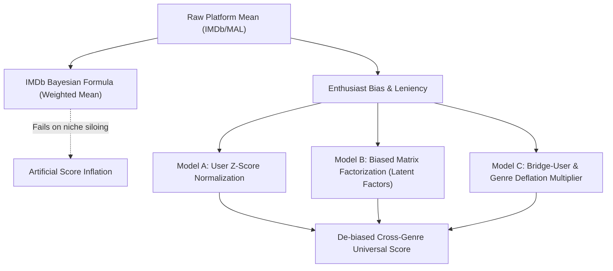

# UniversalRatingEngine: Cross-Genre Quality Calibration Report
**Dataset**: `ml-32m` | **Titles Evaluated**: 19,669 | **Total Ratings Evaluated**: 31,637,476

> [!NOTE]
> Public review platforms (IMDb, MyAnimeList, Letterboxd) suffer from severe self-selection bias and contextual anchoring. Niche genres attract loyalist enthusiasts who inflate scores, while broad mainstream titles suffer score drag from mismatched audiences. This report presents calibrated scores produced by decomposing user leniency and item latent quality.

## Global Dataset Overview
- **Population Mean (Raw 10-point Scale)**: `6.47 / 10.0`
- **Calibrated Latent Mean (Model B)**: `6.80 / 10.0`
- **Calibration Delta Range**: `[-1.27, +3.94]`
- **Maximum Rank Fall**: `14,776` ranks
- **Maximum Rank Rise**: `11,865` ranks

## 1. Top 25 Titles with Biggest Negative Calibration Delta
*Titles artificially inflated by niche enthusiast siloing and sympathetic user bases.*

| # | Title | Genres | Votes | Raw Avg | IMDb Bayes | Model A (Z) | Model B (Latent) | Model C (Bridge) | Delta (Δ) | Rank Shift |
|---|---|---|---|---|---|---|---|---|---|---|
| 1 | **Eraserhead (1977)** | Drama, Horror | 4,545 | 7.30 | 7.30 | 7.33 | **6.03** | 7.14 | `-1.27` | Dropped 14,776 ranks due to enthusiast bias |
| 2 | **Raging Bull (1980)** | Drama | 13,049 | 8.08 | 8.07 | 8.04 | **6.85** | 7.73 | `-1.22` | Dropped 9,269 ranks due to enthusiast bias |
| 3 | **8 1/2 (8½) (1963)** | Drama, Fantasy | 4,322 | 8.05 | 8.04 | 8.04 | **6.83** | 7.42 | `-1.22` | Dropped 9,635 ranks due to enthusiast bias |
| 4 | **Cries and Whispers (Viskningar och rop) (1972)** | Drama | 1,037 | 7.95 | 7.91 | 8.07 | **6.76** | 7.61 | `-1.19` | Dropped 10,783 ranks due to enthusiast bias |
| 5 | **Eclisse, L' (Eclipse) (1962)** | Drama | 467 | 7.93 | 7.84 | 8.02 | **6.75** | 7.59 | `-1.17` | Dropped 10,838 ranks due to enthusiast bias |
| 6 | **Touch of Evil (1958)** | Crime, Film-Noir, Thriller | 5,718 | 8.25 | 8.24 | 8.20 | **7.09** | 7.82 | `-1.16` | Dropped 5,249 ranks due to enthusiast bias |
| 7 | **Persona (1966)** | Drama | 2,694 | 8.17 | 8.15 | 8.29 | **7.01** | 7.82 | `-1.16` | Dropped 6,587 ranks due to enthusiast bias |
| 8 | **Aguirre: The Wrath of God (Aguirre, der Zorn Gottes) (1972)** | Adventure, Drama | 2,313 | 7.93 | 7.92 | 8.08 | **6.81** | 7.34 | `-1.12` | Dropped 9,688 ranks due to enthusiast bias |
| 9 | **M (1931)** | Crime, Film-Noir, Thriller | 5,728 | 8.30 | 8.29 | 8.32 | **7.20** | 7.87 | `-1.11` | Dropped 3,477 ranks due to enthusiast bias |
| 10 | **Mirror, The (Zerkalo) (1975)** | Drama | 1,266 | 8.04 | 8.01 | 8.20 | **6.95** | 7.70 | `-1.09` | Dropped 7,386 ranks due to enthusiast bias |
| 11 | **Human Condition III, The (Ningen no joken III) (1961)** | Drama, War | 142 | 8.22 | 7.93 | 8.89 | **7.13** | 8.35 | `-1.09` | Dropped 4,438 ranks due to enthusiast bias |
| 12 | **Avventura, L' (Adventure, The) (1960)** | Drama, Mystery, Romance | 865 | 7.82 | 7.78 | 7.89 | **6.75** | 7.28 | `-1.07` | Dropped 10,635 ranks due to enthusiast bias |
| 13 | **Manhattan (1979)** | Comedy, Drama, Romance | 10,130 | 8.08 | 8.07 | 7.97 | **7.01** | 7.58 | `-1.07` | Dropped 6,561 ranks due to enthusiast bias |
| 14 | **Grand Illusion (La grande illusion) (1937)** | Drama, War | 1,963 | 8.23 | 8.20 | 8.29 | **7.16** | 8.36 | `-1.07` | Dropped 4,022 ranks due to enthusiast bias |
| 15 | **Wild Strawberries (Smultronstället) (1957)** | Drama | 2,828 | 8.17 | 8.15 | 8.28 | **7.10** | 7.82 | `-1.07` | Dropped 4,910 ranks due to enthusiast bias |
| 16 | **Brazil (1985)** | Fantasy, Sci-Fi | 18,702 | 8.01 | 8.01 | 7.99 | **6.94** | 7.40 | `-1.07` | Dropped 7,561 ranks due to enthusiast bias |
| 17 | **Satan's Tango (Sátántangó) (1994)** | Drama | 182 | 7.90 | 7.72 | 8.23 | **6.83** | 7.56 | `-1.07` | Dropped 9,297 ranks due to enthusiast bias |
| 18 | **It's Such a Beautiful Day (2012)** | Animation, Comedy, Drama, Fantasy, Sci-Fi | 706 | 8.14 | 8.07 | 8.46 | **7.07** | 7.83 | `-1.06` | Dropped 5,358 ranks due to enthusiast bias |
| 19 | **Ran (1985)** | Drama, War | 6,350 | 8.28 | 8.27 | 8.30 | **7.22** | 8.41 | `-1.06` | Dropped 3,057 ranks due to enthusiast bias |
| 20 | **Crumb (1994)** | Documentary | 6,363 | 8.00 | 7.99 | 7.99 | **6.95** | 7.38 | `-1.05` | Dropped 7,473 ranks due to enthusiast bias |
| 21 | **Scenes From a Marriage (Scener ur ett äktenskap) (1973)** | Drama | 806 | 8.17 | 8.11 | 8.35 | **7.13** | 7.83 | `-1.05` | Dropped 4,486 ranks due to enthusiast bias |
| 22 | **Sunset Blvd. (a.k.a. Sunset Boulevard) (1950)** | Drama, Film-Noir, Romance | 9,071 | 8.39 | 8.38 | 8.36 | **7.35** | 7.85 | `-1.05` | Dropped 1,692 ranks due to enthusiast bias |
| 23 | **Conformist, The (Conformista, Il) (1970)** | Drama | 1,239 | 7.97 | 7.93 | 8.06 | **6.92** | 7.63 | `-1.04` | Dropped 7,796 ranks due to enthusiast bias |
| 24 | **400 Blows, The (Les quatre cents coups) (1959)** | Crime, Drama | 4,201 | 8.18 | 8.17 | 8.21 | **7.14** | 7.81 | `-1.04` | Dropped 4,231 ranks due to enthusiast bias |
| 25 | **The Lighthouse (2019)** | Drama, Fantasy, Horror | 3,193 | 7.58 | 7.58 | 7.46 | **6.56** | 7.18 | `-1.03` | Dropped 12,563 ranks due to enthusiast bias |

---

## 2. Top 25 Titles with Biggest Positive Calibration Delta
*Titles penalized by mismatched casual viewers, critical general audiences, or harsh rating environments.*

| # | Title | Genres | Votes | Raw Avg | IMDb Bayes | Model A (Z) | Model B (Latent) | Model C (Bridge) | Delta (Δ) | Rank Shift |
|---|---|---|---|---|---|---|---|---|---|---|
| 1 | **Saving Christmas (2014)** | Children, Comedy | 35 | 1.74 | 4.89 | 2.31 | **5.69** | 1.65 | `+3.94` | Gained 297 ranks due to harsh audience penalty |
| 2 | **Foodfight! (2012)** | Action, Animation, Children, Comedy | 46 | 1.98 | 4.64 | 2.70 | **5.70** | 1.92 | `+3.72` | Gained 307 ranks due to harsh audience penalty |
| 3 | **Hip Hop Witch, Da (2000)** | Comedy, Horror, Thriller | 30 | 1.73 | 5.08 | 2.79 | **5.44** | 1.67 | `+3.71` | Gained 121 ranks due to harsh audience penalty |
| 4 | **Pledge This! (2006)** | Comedy | 30 | 2.33 | 5.31 | 1.89 | **5.55** | 2.22 | `+3.21` | Gained 177 ranks due to harsh audience penalty |
| 5 | **The Best Movie 2 (2009)** | Comedy | 32 | 2.50 | 5.30 | 2.07 | **5.60** | 2.37 | `+3.10` | Gained 204 ranks due to harsh audience penalty |
| 6 | **Faces of Death 6 (1996)** | Documentary, Horror | 172 | 2.57 | 3.59 | 3.11 | **5.57** | 2.47 | `+3.00` | Gained 187 ranks due to harsh audience penalty |
| 7 | **Who's Your Caddy? (2007)** | Comedy | 51 | 3.18 | 5.12 | 3.94 | **6.14** | 3.02 | `+2.96` | Gained 1,473 ranks due to harsh audience penalty |
| 8 | **Faces of Death 5 (1996)** | Documentary, Horror | 153 | 2.73 | 3.80 | 3.37 | **5.66** | 2.62 | `+2.94` | Gained 250 ranks due to harsh audience penalty |
| 9 | **Faces of Death: Fact or Fiction? (1999)** | Documentary, Horror | 125 | 2.78 | 4.02 | 3.51 | **5.71** | 2.67 | `+2.93` | Gained 304 ranks due to harsh audience penalty |
| 10 | **Electrocuting an Elephant (1903)** | Documentary | 30 | 3.13 | 5.61 | 3.29 | **6.04** | 2.89 | `+2.90` | Gained 1,011 ranks due to harsh audience penalty |
| 11 | **SuperBabies: Baby Geniuses 2 (2004)** | Comedy | 257 | 1.73 | 2.60 | 2.02 | **4.63** | 1.64 | `+2.90` | Gained 4 ranks due to harsh audience penalty |
| 12 | **Horrors of Spider Island (Ein Toter Hing im Netz) (1960)** | Horror, Sci-Fi | 67 | 3.10 | 4.81 | 3.84 | **5.99** | 3.04 | `+2.89` | Gained 852 ranks due to harsh audience penalty |
| 13 | **The Pumaman (1980)** | Action, Adventure, Fantasy, Sci-Fi | 76 | 3.07 | 4.66 | 3.36 | **5.93** | 2.80 | `+2.86` | Gained 685 ranks due to harsh audience penalty |
| 14 | **Faces of Death 4 (1990)** | Documentary, Horror | 177 | 2.76 | 3.71 | 3.33 | **5.61** | 2.65 | `+2.85` | Gained 207 ranks due to harsh audience penalty |
| 15 | **Always Be My Maybe (2016)** | Comedy, Romance | 31 | 3.74 | 5.81 | 5.61 | **6.59** | 3.48 | `+2.85` | Gained 5,539 ranks due to harsh audience penalty |
| 16 | **Up the Academy (1980)** | Comedy | 55 | 3.51 | 5.22 | 3.81 | **6.35** | 3.33 | `+2.84` | Gained 2,866 ranks due to harsh audience penalty |
| 17 | **Big Bad Mama II (1987)** | Action, Comedy | 41 | 3.17 | 5.33 | 4.27 | **5.96** | 2.96 | `+2.79` | Gained 754 ranks due to harsh audience penalty |
| 18 | **Prom Night III: The Last Kiss (1989)** | Horror | 192 | 3.17 | 3.98 | 4.34 | **5.96** | 3.16 | `+2.78` | Gained 746 ranks due to harsh audience penalty |
| 19 | **Unearthly, The (1957)** | Horror, Sci-Fi | 33 | 3.64 | 5.72 | 4.53 | **6.41** | 3.56 | `+2.77` | Gained 3,361 ranks due to harsh audience penalty |
| 20 | **Car 54, Where Are You? (1994)** | Comedy | 84 | 3.48 | 4.83 | 4.01 | **6.24** | 3.30 | `+2.76` | Gained 2,001 ranks due to harsh audience penalty |
| 21 | **Levottomat 3 (2004)** | Romance | 40 | 3.30 | 5.41 | 3.47 | **6.06** | 3.00 | `+2.76` | Gained 1,090 ranks due to harsh audience penalty |
| 22 | **Justin Bieber: Never Say Never (2011)** | Documentary | 63 | 2.48 | 4.52 | 3.06 | **5.23** | 2.29 | `+2.76` | Gained 32 ranks due to harsh audience penalty |
| 23 | **Mitchell (1975)** | Action, Crime | 90 | 3.14 | 4.55 | 3.38 | **5.88** | 2.94 | `+2.74` | Gained 560 ranks due to harsh audience penalty |
| 24 | **DarkWolf (2003)** | Horror | 31 | 2.77 | 5.44 | 3.25 | **5.51** | 2.77 | `+2.74` | Gained 142 ranks due to harsh audience penalty |
| 25 | **Prom Night IV: Deliver Us From Evil (1992)** | Horror | 156 | 2.94 | 3.94 | 4.23 | **5.67** | 2.93 | `+2.73` | Gained 252 ranks due to harsh audience penalty |

---

## 3. Cross-Genre Calibration & Inflation Summary
*Comparison of average raw scores versus de-biased quality metrics across genres.*

| Genre | Titles | Total Votes | Raw Avg | Bayes Avg | Model A (Z) | Model B (Latent) | Model C (Bridge) | Cal. Delta (Δ) | Siloing Diagnosis |
|---|---|---|---|---|---|---|---|---|---|
| **Film-Noir** | 189 | 302,746 | 7.13 | 7.22 | 7.44 | 7.01 | 6.75 | `-0.120` | 🟠 Moderate Inflation |
| **Documentary** | 1,204 | 387,472 | 7.11 | 7.15 | 7.49 | 7.13 | 6.60 | `+0.017` | 🟢 Well-Balanced Audience |
| **War** | 750 | 1,584,133 | 6.92 | 7.02 | 7.19 | 7.02 | 6.89 | `+0.101` | 🔵 Mismatched Audience Drag |
| **Drama** | 9,153 | 13,828,346 | 6.74 | 6.88 | 6.99 | 6.92 | 6.42 | `+0.178` | 🟣 Heavily Underrated / Dragged Down |
| **IMAX** | 182 | 1,494,003 | 6.49 | 6.56 | 6.46 | 6.68 | 6.19 | `+0.190` | 🟣 Heavily Underrated / Dragged Down |
| **Animation** | 1,218 | 2,191,308 | 6.60 | 6.78 | 6.91 | 6.82 | 6.46 | `+0.218` | 🟣 Heavily Underrated / Dragged Down |
| **Musical** | 597 | 1,155,249 | 6.58 | 6.75 | 6.77 | 6.80 | 6.13 | `+0.220` | 🟣 Heavily Underrated / Dragged Down |
| **Western** | 358 | 591,033 | 6.62 | 6.80 | 6.91 | 6.85 | 6.33 | `+0.226` | 🟣 Heavily Underrated / Dragged Down |
| **Romance** | 2,855 | 5,482,000 | 6.60 | 6.75 | 6.78 | 6.83 | 6.16 | `+0.237` | 🟣 Heavily Underrated / Dragged Down |
| **Crime** | 2,200 | 5,345,285 | 6.58 | 6.74 | 6.83 | 6.87 | 6.23 | `+0.287` | 🟣 Heavily Underrated / Dragged Down |
| **Mystery** | 1,181 | 2,598,768 | 6.52 | 6.72 | 6.77 | 6.83 | 6.17 | `+0.306` | 🟣 Heavily Underrated / Dragged Down |
| **Fantasy** | 1,307 | 3,685,868 | 6.34 | 6.54 | 6.53 | 6.66 | 5.89 | `+0.322` | 🟣 Heavily Underrated / Dragged Down |
| **Adventure** | 1,994 | 7,569,884 | 6.34 | 6.52 | 6.51 | 6.68 | 5.90 | `+0.348` | 🟣 Heavily Underrated / Dragged Down |
| **Comedy** | 6,495 | 11,109,862 | 6.31 | 6.53 | 6.55 | 6.72 | 5.98 | `+0.410` | 🟣 Heavily Underrated / Dragged Down |
| **Thriller** | 3,701 | 8,630,871 | 6.30 | 6.54 | 6.53 | 6.72 | 5.99 | `+0.429` | 🟣 Heavily Underrated / Dragged Down |
| **Action** | 3,006 | 9,624,239 | 6.20 | 6.43 | 6.39 | 6.65 | 5.83 | `+0.453` | 🟣 Heavily Underrated / Dragged Down |
| **Children** | 1,191 | 2,713,325 | 6.10 | 6.35 | 6.32 | 6.56 | 5.81 | `+0.468` | 🟣 Heavily Underrated / Dragged Down |
| **Sci-Fi** | 1,667 | 5,696,332 | 6.10 | 6.38 | 6.27 | 6.58 | 5.81 | `+0.480` | 🟣 Heavily Underrated / Dragged Down |
| **Horror** | 2,197 | 2,452,886 | 5.80 | 6.20 | 6.11 | 6.46 | 5.63 | `+0.662` | 🟣 Heavily Underrated / Dragged Down |

